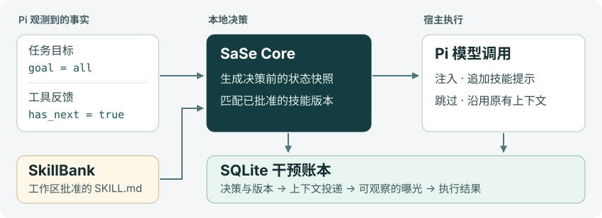

# SaSe · State-aware Skill Evolution

SaSe 是 Pi 的本地技能扩展。每次模型调用前，它把**用户要完成的目标**和**工具刚刚返回的事实**放在一起，决定是否给模型一条已批准的技能提示。Pi 负责模型调用和工具执行，SaSe 把每次决定及其依据保存在本地 SQLite 中。

## 从一个分页任务看决策

工具返回“还有下一页”时，要不要继续取数，取决于用户要几页。仓库自带的分页工具和 `paginate` 技能可以重现三种结果。

| 任务目标 | 当前页反馈 | SaSe 决策 |
| --- | --- | --- |
| 获取全部记录 | 有下一页 | 注入分页技能，提示按游标继续读取 |
| 获取全部记录 | 已到末页 | 跳过，读取范围已覆盖 |
| 只获取第一页 | 有下一页 | 跳过，已达到用户指定的范围 |



**同一次逻辑调用只分配一次。** Pi 重试时复用相同的决策和技能版本。账本分别记录插件修改了哪次调用的上下文，以及在哪个观察位置发现了完整提示。演示还会在独立的 HTTP 接收端检查每次请求实际携带的内容。

## 运行本地演示

在仓库根目录执行。需要 Python 3.10+、Node.js 22.19+ 和 npm。演示使用真实的 Pi 1.6.0 工具循环和本地脚本化模型服务，无需 API 密钥。

```sh
npm ci
npm run demo -- --case=all-more --keep-evidence
```

演示会让一次模型请求收到 503，然后验证重试前后的两个请求各携带一份相同的提示。最后一行给出可直接运行的 `inspect` 命令，用它查看本次运行的目标、页状态、技能内容哈希和回执。运行 `make test` 可复现三个决策场景、重试及故障测试。运行 `make bench` 可单独测量从 Pi 客户端发起决策到收到 SQLite 提交结果的延迟。

## 接入自己的 Pi 项目

在已执行 `npm ci` 的 SaSe 仓库中安装 Python 核心，再切换到要启用扩展的项目。项目级安装与技能审批相互独立。

```sh
SASE_REPO="$(pwd -P)"
python3 -m venv .venv
.venv/bin/python -m pip install -e .
export SASE_PYTHON="$SASE_REPO/.venv/bin/python"
PI_BIN="$SASE_REPO/node_modules/.bin/pi"

cd /path/to/your/project
"$PI_BIN" install "$SASE_REPO/plugins/pi" --local --approve
"$SASE_PYTHON" -m sase import "$SASE_REPO/examples/paginate/SKILL.md"
```

审阅该技能后，将以下占位符换成导入时返回的 `skill_version`。批准记录与当前项目绑定。

```sh
"$SASE_PYTHON" -m sase approve 'paginate@<完整内容哈希>'
"$PI_BIN" --approve
```

任务首行写入 `sase.goal=all` 或 `sase.goal=first`，下一行写任务正文。宿主提供名为 `sase_page` 的工具，并在返回值的 `details.has_next` 中给出布尔值。可以直接参考[演示工具实现](scripts/pi-demo-tool.ts)。

扩展在 Pi 会话中复用一个 Python 子进程，同步决策默认最多等待 200 ms。超时或核心退出后，Pi 继续原生执行。使用 `SASE_TIMEOUT_MS` 调整等待时间，使用 `SASE_DB` 覆盖默认数据库 `~/.sase/sase.sqlite3`。SaSe 持久化目标枚举、分页标志、技能版本和证据标识。原始工具行、游标和模型请求正文留在宿主侧。

在目标项目中可检查环境和最近的能力记录，或移除扩展。

```sh
"$SASE_PYTHON" -m sase doctor
"$PI_BIN" remove "$SASE_REPO/plugins/pi" --local --approve
```

## 协议与验证

- [Core 协议](docs/protocol.md) 定义状态快照、版本冻结、重试语义和账本字段。
- [分页配对评估](docs/evaluation.md) 给出 Native、Fixed 和 Gated 三组的运行命令与评分口径。[调用预算试验](docs/bounded-pagination.md) 对照两个技能版本，分别报告严格成功率、工具成本和最终答案中的记录覆盖。
- [本地 Qwen3.8-27B 实验](docs/local-27b-pagination.md) 先校准模型原生的取数与停止行为，再用独立任务比较三种策略。
- [验证记录](docs/verification.md) 列出 Pi 及 provider 的实测范围、故障行为和延迟测量方法。
- 项目采用 [MIT 许可证](LICENSE)。
