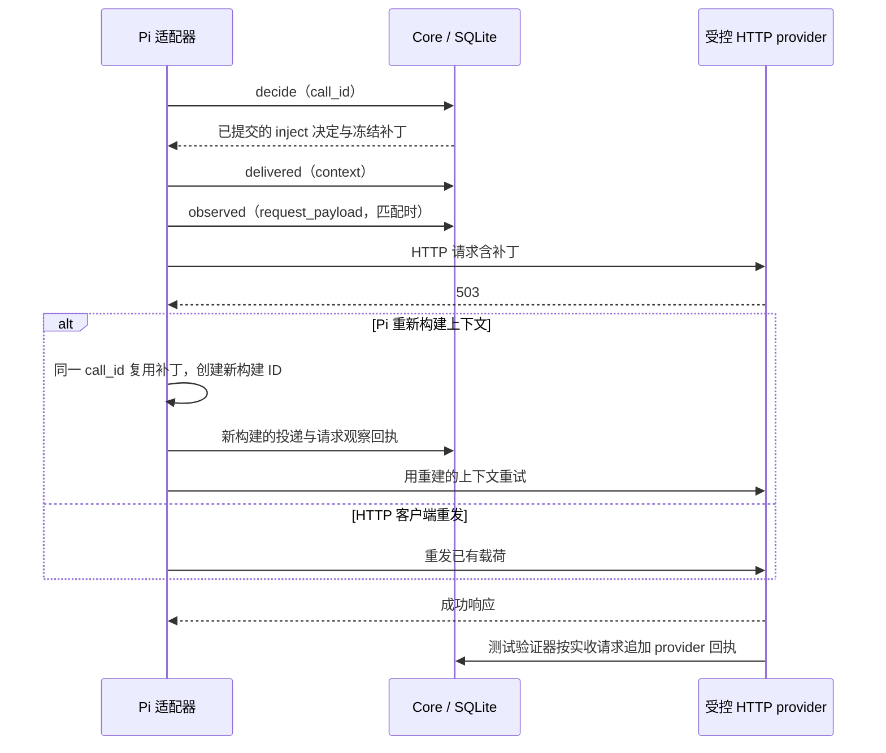

# SaSe Core 协议 v1

适配器把宿主观察到的事实发送给 Core，在每次模型调用前获取一次决策。Core 在同一个 SQLite 事务中读取可见状态与已批准的技能版本，并持久化决策。后续投递、曝光和任务结果通过 `decision_id` 关联。

## 传输与标识

运行 `sase serve` 启动常驻子进程。标准输入和标准输出均为 UTF-8 JSON Lines，每行一个对象，请求帧最大为 1 MiB。请求包含用于配对响应的 `id`（字符串或整数）、协议版本 `v: 1`、操作 `op` 和工作区 `workspace`。例如，查询新工作区的账本时，以下两行分别是请求和响应。

```jsonl
{"id":1,"v":1,"op":"inspect","workspace":"demo"}
{"id":1,"ok":true,"result":{"decisions":[]}}
```

错误响应以 `ok: false` 区分，`error` 可取 `invalid_request` 或 `storage_error`。Pi 客户端默认在 200 ms 后放弃等待，按传输 ID 丢弃迟到的响应。超时后 Core 仍有可能提交决定。重放同一个逻辑调用时应复用业务标识。

| 标识 | 作用范围 |
| --- | --- |
| `workspace / session / run / branch` | 定位事件流，隔离项目、会话、任务和执行分支 |
| `event_id`、`seq` | 流内事实及其逻辑顺序。同一事件可重复提交，内容冲突会被拒绝 |
| `call_id`、`episode_id` | 流内一次逻辑模型调用与所属干预窗口。Pi 适配器将一次调用作为一个 episode |
| `decision_id` | Core 分配的稳定标识，同一流内重复提交同一个 `call_id` 会取回冻结的分配与补丁 |
| `receipt_id`、`outcome_id` | 单条证据的幂等标识。同一决定下以相同 ID 和内容重复提交只计一条 |

## 操作

| 操作 | 输入与行为 |
| --- | --- |
| `import` | `content` 为不超过 16 KiB 的 UTF-8 技能文件，包含单行 `name`、`description` 前置元数据和正文。返回 `skill_version` 与内容 SHA-256，候选存入工作区的 SQLite 技能库。 |
| `approve` | 传入本工作区的 `skill_version`，原子切换同名技能的批准版本。已保存的决策继续引用原版本。 |
| `event` | 传入流标识、`event_id`、`seq`、`kind` 和 `value`。`goal` 接受 `all` 或 `first`。`page` 接受布尔值并要求 `tool_call_id`。两类事件都接受 `null` 或 `"unknown"`，用于明确撤销先前的已知状态。 |
| `decide` | 传入流标识、`call_id`、`episode_id`、`as_of_seq` 和 `capabilities`。可指定 `host` 的 `name` 与 `version`，也可用 `tool_call_id` 选择并行调用中的具体结果。返回 `inject` 或 `skip`、理由、快照及冻结补丁。 |
| `receipt` | 传入 `decision_id`、`receipt_id`、`kind`、`location` 和可选的 `attempt_id`。允许的组合见下方证据表。 |
| `outcome` | 传入 `decision_id`、`outcome_id`、`window`（`proximal` 或 `distal`）及布尔结果 `value`。缺失结果使用 `null` 并附 `missing_reason`。 |
| `inspect` | 可选 `decision_id`。返回冻结的分配、当前可查的证据及结果。每个窗口的摘要给出最近追加的条目，完整历史保存在 `outcomes`。 |

`capabilities` 的五个必填布尔字段为 `observeTools`、`observeModelRequests`、`injectContext`、`confirmExposure`、`nativeSkillEvolution`。Core 保存决策时的能力声明。分页策略依据 `as_of_seq` 及之前可见的目标与反馈检索已批准的 `paginate`。缺失或无法归属的必要事实记为 `unknown`，本次决策为 `skip`。

`outcome.missing_reason` 可取 `unknown`、`unavailable`、`not_observed`、`not_scored`、`not_applicable`、`cancelled`、`timeout` 或 `missing`。

## 曝光与重试



| 记录 | 对应证据 |
| --- | --- |
| `assignment=inject` | Core 决定提供某个技能版本，原始分配的 `exposure_status` 为 `unknown` |
| `delivered / context` | 适配器在本次上下文副本中提供了冻结补丁 |
| `observed / request_payload` | 适配器在其可观察的请求载荷中匹配到了完整补丁。Pi 对 `openai-completions` 启用此观察 |
| `observed / provider` | 独立接收端在实际收到的请求中匹配到了完整补丁 |
| `outcome` | 验证器报告某个近端或远端窗口的结果及缺失情况 |

`inspect` 在至少有一条 `observed` 回执时将汇总曝光状态标为 `observed`，应结合回执位置解释。Pi 的 `context` 和 `request_payload` 使用同一上下文构建的 `attempt_id`。测试 provider 为每个实际 HTTP 尝试独立编号，一次上下文构建可能对应多个传输尝试。进入下一次逻辑模型调用时，适配器重新投影状态并获取新决定。

分页策略记录 `randomized=false`、`propensity=null`。账本支持重放和描述性评估。估计技能的因果效用需要对照实验。适配器仅发送允许的目标枚举、页状态、标识及版本，工具原文、游标、认证头和完整请求载荷留在宿主侧。技能正文随显式导入保存在工作区技能库中。

配对评估可以在 `decide` 中显式指定 `evaluation_policy` 为 `fixed` 或 `gated`。适配器额外提交 `kind=first_page` 布尔事实，并用相同的序号与工具调用 ID 关联分页反馈。评估账本中的 `eligibility` 表示是否具有本次干预机会；合格的 Gated 决策也可能选择跳过。每个运行只消费一次成功首页结果对应的机会。[评估协议](evaluation.md)
